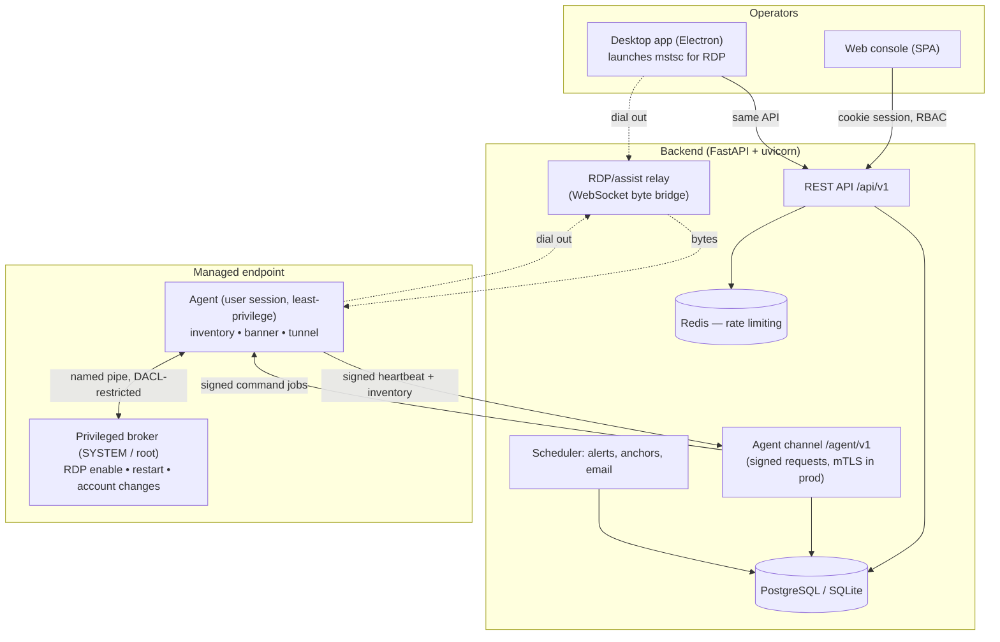
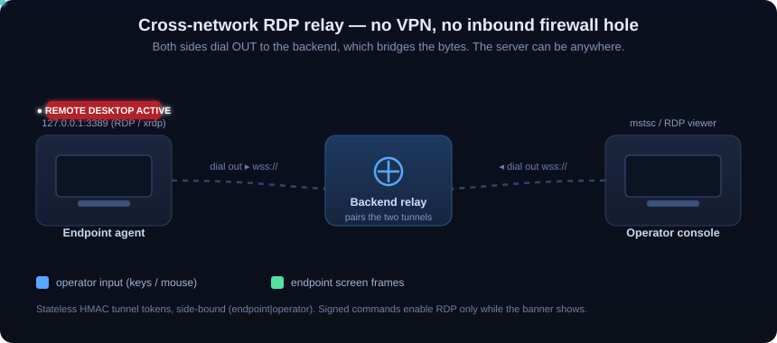
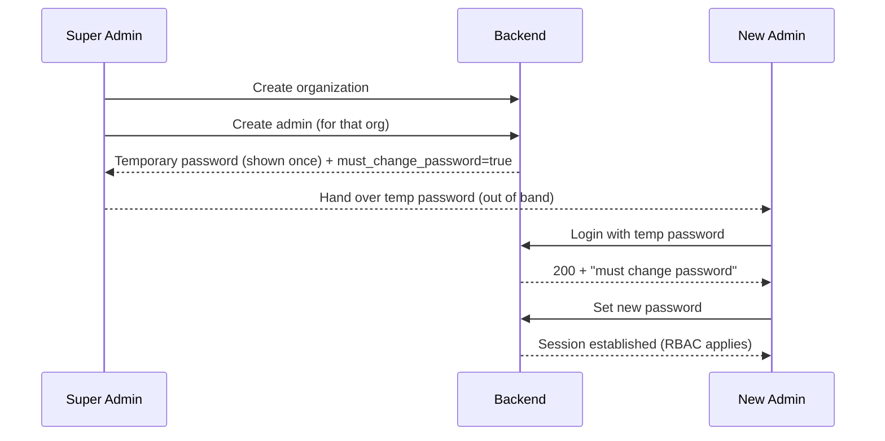
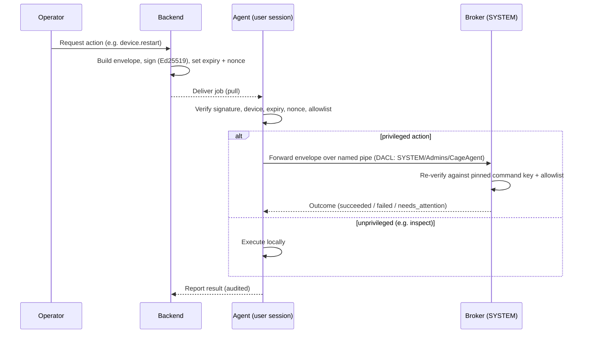
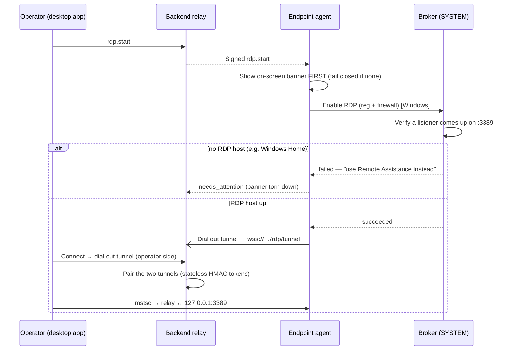
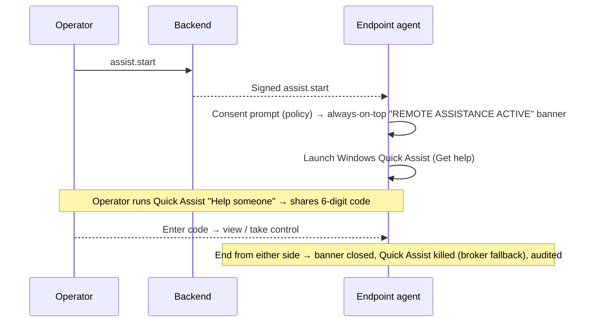
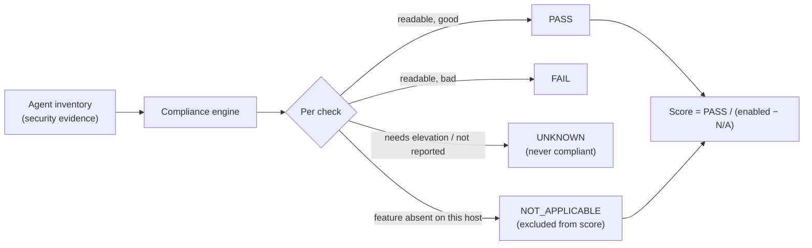
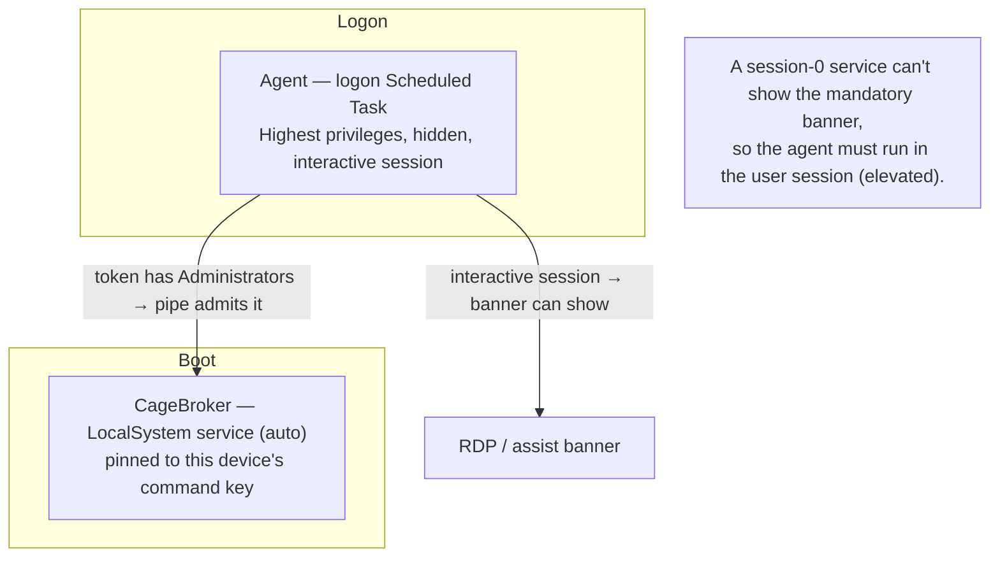
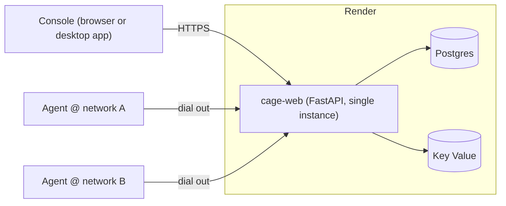

# 15 — Architecture & Flows (visual guide)

A diagram-first tour of **Antiquarian's Cage**: what the pieces are, how they talk, and how the main
journeys work end to end. The flow diagrams are [Mermaid](https://mermaid.js.org/) (GitHub renders them
inline); the relay animation is an SVG (open it directly for the full animation).

> New to the project? Start with [`00-complete-guide.md`](00-complete-guide.md) for prose, then come back here
> for the pictures. Security model: [`SECURITY.md`](../SECURITY.md). Remote admin: [`07-remote-administration.md`](07-remote-administration.md).

---

## 1. What it is, in one picture

Antiquarian's Cage is an **endpoint management + security platform**: a web console (also shippable as a
Windows desktop app), a FastAPI backend, and a cross-platform **agent** on each managed endpoint. Everything
an admin does to an endpoint travels as a **signed, allowlisted command**; anything privileged is executed by
a separate **broker** running as SYSTEM/root, so the network-facing agent stays least-privilege.



**Key idea:** the agent and broker are two **processes** with different privilege. The agent never holds admin
rights it doesn't need; it asks the broker (over a locked-down local pipe) to perform privileged actions, and
the broker refuses anything that isn't a correctly **signed, allowlisted** command for *this* device.

---

## 2. The cross-network relay (animated)

Remote Desktop and Remote Assistance work **across any network with no VPN and no inbound firewall hole**: the
endpoint and the operator *both dial out* to the backend, which pairs the two WebSocket tunnels and copies bytes
between them. The relay carries RDP straight to the endpoint's `127.0.0.1:3389`.



*(GitHub may show the SVG statically; open `documentation/assets/relay-flow.svg` in a browser to see the packets move.)*

---

## 3. Enrollment — how an endpoint joins

```mermaid
sequenceDiagram
  participant Admin as Admin (console)
  participant API as Backend
  participant Agent as Endpoint agent
  Admin->>API: Create enrollment token (label, validity or "Never")
  API-->>Admin: One-time token (shown once, stored hashed)
  Note over Agent: cage-agent enroll --server … --token …
  Agent->>Agent: Generate P-256 key (DPAPI/machine-id wrapped)
  Agent->>API: Enroll: token + CSR + hostname
  API->>API: Validate token (unused, not expired*), issue device cert (CN = device UUID)
  API-->>Agent: Device certificate + config
  Agent->>API: Signed heartbeat + inventory (timestamp, nonce, body hash)
  Note over Admin,API: Endpoint shows Online; inventory + compliance populate
```

\* **Indefinite tokens:** choosing *"Never (indefinite)"* stores a null `expires_at`, so the token never expires
(the expiry check is skipped). Handy so you don't "lose" the ability to (re)enroll an endpoint.

---

## 4. Sign-in & Super-Admin provisioning

Console sign-in is **password-based** (PBKDF2-HMAC-SHA256). Super Admins create organizations and admins; a new
admin is handed a **one-time temporary password** and is forced to reset it on first login.



Break-glass recovery for a sole Super Admin: `python -m app.recover <email>`.

---

## 5. A privileged remote action (the signing chain)

Every remote action — restart, log off, disable account, remove-from-Administrators, RDP enable — is a **signed
command envelope**. Three independent layers validate it: the backend signs, the agent verifies + checks its own
allowlist, the broker re-verifies before doing anything privileged.



On **Linux** there is no separate broker process: the agent runs as a **root** systemd service and performs the
privileged action itself, with the same signed-envelope validation.

---

## 6. Remote Desktop session (end to end)



* **Windows Home can't host RDP** (no RDP server) — the broker detects this and returns a clear message instead of
  a cryptic `mstsc` dialog. Use a **Pro/Enterprise** endpoint, or **Remote Assistance** below.
* **Linux** uses **xrdp** as the host; the agent enables it directly (no broker) and shows the banner in the
  logged-in desktop session; it fails closed if there is no graphical session.

---

## 7. Remote Assistance (works on Home)



---

## 8. Compliance evaluation



* The agent reports security evidence; the engine turns it into PASS/FAIL/UNKNOWN/NOT_APPLICABLE.
* Elevation-gated checks (**Secure Boot, BitLocker, audit policy**) report **UNKNOWN** when the agent runs
  **unprivileged** — run the agent **elevated** (the auto-start task does) to resolve them.
* **BitLocker on Windows Home** is **NOT_APPLICABLE** (Home has no BitLocker) so it never drags the score down.
* Disable checks that don't apply to your fleet on the Compliance page.

---

## 9. Auto-start topology (Windows) & cloud deployment

How the agent + broker run unattended, and why the agent is a **logon task** (not a service):



Cloud (Render free tier): one public web service runs the FastAPI backend serving the **console SPA + /api +
/agent + the relay WebSockets** on one HTTPS origin (no VPN; agents dial out). See
[`13-cloud-deployment.md`](13-cloud-deployment.md).



---

## 10. Using it — the happy path

1. **Deploy the backend** (local, Docker, or cloud → [`13-cloud-deployment.md`](13-cloud-deployment.md)) and open the console.
2. **Bootstrap** the first Super Admin, then **create an organization** and an **admin** (hand over the temp password).
3. **Enrol an endpoint:** console → Endpoints → *Enrol an endpoint* (pick validity, or *Never*). Run the printed
   `cage-agent enroll …` on the endpoint.
4. **Install for auto-start** (optional, recommended): `agent/installer/install.ps1` (Windows) or
   `agent/installer/linux/install.sh` (Linux) → broker + agent start on every boot/logon.
5. **Manage it:** inventory, compliance, policies, remote actions, Remote Desktop (Pro/Linux) or Remote
   Assistance (any Windows), all audited.

| I want to… | Where |
|---|---|
| Understand the security model | [`SECURITY.md`](../SECURITY.md), [`03-security-and-windows.md`](03-security-and-windows.md) |
| Remote actions / RDP / assistance | [`07-remote-administration.md`](07-remote-administration.md) |
| Password auth & SSO | [`08-identity-and-sso.md`](08-identity-and-sso.md) |
| Deploy to the cloud | [`13-cloud-deployment.md`](13-cloud-deployment.md) |
| Ship the desktop app / auto-start | [`14-desktop-app.md`](14-desktop-app.md) |
| What's actually verified | [`test-log.md`](test-log.md) |
